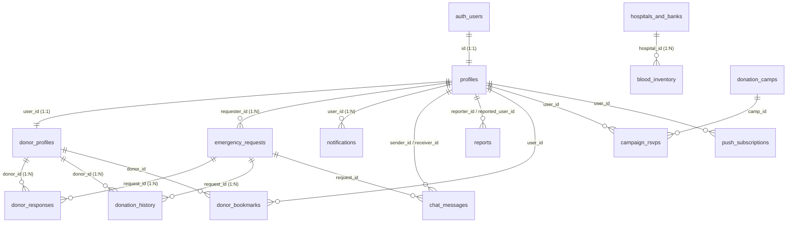

# রক্তদাতা (Roktodata) — পূর্ণাঙ্গ ডেটাবেজ স্কিমা ও আর্কিটেকচার ডকুমেন্টেশন
**ভার্সন:** ৩.০ (প্রোডাকশন-গ্রেড) | **ডেটাবেজ:** Supabase (PostgreSQL 15+)

---

## ১. সারসংক্ষেপ (Executive Summary)

রক্তদাতা প্ল্যাটফর্মের ডেটাবেজ আর্কিটেকচারটি অত্যন্ত গতিশীল, রিয়েল-টাইম উপযোগী এবং ডেটা ইন্টিগ্রিটি বজায় রাখার জন্য ডিজাইন করা হয়েছে। সিস্টেমে মোট **১৬টি সত্তা** (১৫টি প্রোডাকশন টেবিল + ১টি ভৌগোলিক রেফারেন্স টেবিল), **২টি লাইভ ভিউ**, **৩টি অটোমেটিক ট্রিগার ফাংশন** এবং **রিয়েল-টাইম পাবলিকেশন** অন্তর্ভুক্ত রয়েছে।

---

## ২. সত্তা-সম্পর্ক চিত্র (Entity-Relationship Diagram)



---

## ৩. প্রতিটি টেবিলের পূর্ণাঙ্গ স্কিমা ও কনস্ট্রেইন্ট

### ১. `profiles` (ব্যবহারকারী ও সদস্য প্রোফাইল)
ব্যবহারকারীর প্রাথমিক পরিচয়, যোগাযোগের তথ্য, রক্তের গ্রুপ এবং ভৌগোলিক অবস্থান ধারণ করে।
* **Primary Key:** `id` (UUID, `REFERENCES auth.users(id) ON DELETE CASCADE`)
* **Foreign Key:** `auth.users(id)`
* **Delete Behavior:** ব্যবহারকারী তার মূল অ্যাকাউন্ট মুছে ফেললে প্রোফাইল স্বয়ংক্রিয়ভাবে মুছে যাবে (`CASCADE`)।

| কলাম নাম | ডেটার ধরন | কনস্ট্রেইন্ট / ডিফল্ট | বিবরণ |
| :--- | :--- | :--- | :--- |
| `id` | `UUID` | PK, FK `auth.users(id)` | সুপাবেস অথেন্টিকেশন আইডি |
| `phone_number` | `VARCHAR(20)` | UNIQUE, NOT NULL | মোবাইল নম্বর (লগইন ও যোগাযোগের জন্য) |
| `full_name` | `VARCHAR(100)` | NOT NULL | ব্যবহারকারীর পূর্ণ নাম |
| `blood_group` | `VARCHAR(5)` | NOT NULL, CHECK in 8 groups | রক্তের গ্রুপ (`A+`, `A-`, `B+`, `B-`, `O+`, `O-`, `AB+`, `AB-`) |
| `division` | `VARCHAR(50)` | NOT NULL | বিভাগের নাম (যেমন: ঢাকা, রাজশাহী) |
| `district` | `VARCHAR(50)` | NOT NULL | জেলার নাম |
| `upazila` | `VARCHAR(50)` | NULL | উপজেলার নাম |
| `gender` | `VARCHAR(10)` | CHECK (`male`, `female`, `other`) | লিঙ্গ (কুলডাউন গণনার জন্য) |
| `date_of_birth` | `DATE` | NULL | জন্ম তারিখ |
| `role` | `VARCHAR(20)` | DEFAULT `'donor'` | রোল (`user`, `donor`, `hospital_admin`, `volunteer`, `admin`) |
| `latitude` | `NUMERIC(9,6)` | NULL | ভৌগোলিক অক্ষাংশ |
| `longitude` | `NUMERIC(9,6)` | NULL | ভৌগোলিক দ্রাঘিমাংশ |
| `avatar_url` | `TEXT` | NULL | প্রোফাইল ছবি লিঙ্ক |
| `text_size_preference` | `VARCHAR(10)` | DEFAULT `'100%'` | ফন্ট সাইজ প্র্যাক্সিস |
| `is_verified` | `BOOLEAN` | DEFAULT `false` | প্রোফাইল যাচাই অবস্থা |
| `created_at` | `TIMESTAMPTZ` | DEFAULT `NOW()` | তৈরি হওয়ার সময় |
| `updated_at` | `TIMESTAMPTZ` | DEFAULT `NOW()` | হালনাগাদের সময় (Auto-updated via trigger) |

* **ইন্ডেক্স:**
  * `idx_profiles_district` ON `(district)`
  * `idx_profiles_division` ON `(division)`
  * `idx_profiles_district_upazila` ON `(district, upazila)`
  * `idx_profiles_blood_group` ON `(blood_group)`
  * `idx_profiles_role` ON `(role)`
  * `idx_profiles_gps` ON `(latitude, longitude)`

---

### ২. `donor_profiles` (রক্তদাতা স্ট্যাটাস ও প্রাপ্যতা)
রক্তদাতার নির্দিষ্ট তথ্য, প্রাপ্যতা সুইচ, রক্তদানের ইতিহাস ট্র্যাকার এবং কুলডাউন হিসাব ধারণ করে।
* **Primary Key:** `id` (UUID, `DEFAULT gen_random_uuid()`)
* **Foreign Key:** `user_id` (`REFERENCES public.profiles(id) ON DELETE CASCADE UNIQUE NOT NULL`)
* **Delete Behavior:** ইউজার প্রোফাইল মুছে গেলে ডোনার স্ট্যাটাস স্বয়ংক্রিয়ভাবে ডিলিট হবে (`CASCADE`)।

| কলাম নাম | ডেটার ধরন | কনস্ট্রেইন্ট / ডিফল্ট | বিবরণ |
| :--- | :--- | :--- | :--- |
| `id` | `UUID` | PK, `gen_random_uuid()` | ডোনার প্রোফাইল আইডি |
| `user_id` | `UUID` | UNIQUE, NOT NULL, FK `profiles(id)` | মূল প্রোফাইলের সাথে ১:১ সম্পর্ক |
| `is_available` | `BOOLEAN` | DEFAULT `true` | রক্তদানের বর্তমান প্রাপ্যতা সুইচ |
| `total_donations` | `INTEGER` | DEFAULT `0`, CHECK `>= 0` | মোট রক্তদানের সংখ্যা |
| `last_donation_date` | `DATE` | NULL | সর্বশেষ রক্তদানের তারিখ |
| `next_eligible_date` | `DATE` | NULL | পরবর্তী রক্তদানের সম্ভাব্য তারিখ (৯০ দিনের কুলডাউন) |
| `is_fast_responder` | `BOOLEAN` | DEFAULT `false` | দ্রুত সাড়াদানকারী ব্যাজ |
| `national_id_verified` | `BOOLEAN` | DEFAULT `false` | জাতীয় পরিচয়পত্র যাচাইকৃত কিনা |
| `privacy_hide_phone` | `BOOLEAN` | DEFAULT `true` | ফোন নম্বর গোপন রাখার প্রাইভেসি সেটিংস |
| `reward_points` | `INTEGER` | DEFAULT `100`, CHECK `>= 0` | অর্জিত রিওয়ার্ড পয়েন্টস |
| `badges` | `JSONB` | DEFAULT `'["নতুন সদস্য"]'::jsonb` | অর্জিত ব্যাজের তালিকা |
| `preferred_donation_areas` | `JSONB` | DEFAULT `'[]'::jsonb` | রক্তদানের পছন্দের হাসপাতাল/উপজেলা |
| `created_at` | `TIMESTAMPTZ` | DEFAULT `NOW()` | তৈরি হওয়ার সময় |
| `updated_at` | `TIMESTAMPTZ` | DEFAULT `NOW()` | হালনাগাদের সময় |

* **ইন্ডেক্স:**
  * `idx_donor_available` ON `(is_available)`
  * `idx_donor_user_avail` ON `(user_id, is_available)`
  * `idx_donor_next_eligible` ON `(next_eligible_date)`
  * `idx_donor_points` ON `(reward_points DESC)`

---

### ৩. `emergency_requests` (জরুরি রক্তের আবেদন)
রক্তের চাহিদা, রোগীর তথ্য, হাসপাতাল, ব্যাগের সংখ্যা এবং আবেদনের লাইভ স্ট্যাটাস ধারণ করে।
* **Primary Key:** `id` (UUID, `DEFAULT gen_random_uuid()`)
* **Foreign Key:** `requester_id` (`REFERENCES public.profiles(id) ON DELETE SET NULL`)
* **Delete Behavior:** অনুরোধকারী ব্যবহারকারী তার অ্যাকাউন্ট মুছে ফেললেও হাসপাতালের রোগীর জরুরি রক্তের অনুরোধ বা রেকর্ড মুছে যাবে না, অডিট ট্রেইলের জন্য `requester_id` ফিল্ড `NULL` হবে।

| কলাম নাম | ডেটার ধরন | কনস্ট্রেইন্ট / ডিফল্ট | বিবরণ |
| :--- | :--- | :--- | :--- |
| `id` | `UUID` | PK, `gen_random_uuid()` | অনুরোধ আইডি |
| `requester_id` | `UUID` | NULL, FK `profiles(id)` | যিনি আবেদন করেছেন |
| `blood_group` | `VARCHAR(5)` | NOT NULL, CHECK in 8 groups | প্রয়োজনীয় রক্তের গ্রুপ |
| `bags_needed` | `INTEGER` | DEFAULT `1`, CHECK `> 0 AND <= 20` | কত ব্যাগ রক্ত প্রয়োজন |
| `bags_fulfilled` | `INTEGER` | DEFAULT `0`, CHECK `>= 0` | কত ব্যাগ সংগ্রহ হয়েছে |
| `component_type` | `VARCHAR(20)` | DEFAULT `'whole'` | উপাদানের ধরন (`whole`, `platelets`, `plasma`) |
| `hospital_name` | `VARCHAR(200)` | NOT NULL | হাসপাতালের নাম |
| `division` | `VARCHAR(50)` | DEFAULT `'ঢাকা'` | বিভাগ |
| `district` | `VARCHAR(50)` | NOT NULL | জেলা |
| `upazila` | `VARCHAR(100)` | NULL | উপজেলা |
| `location_detail` | `VARCHAR(150)` | NULL | সুনির্দিষ্ট ঠিকানা বা ল্যান্ডমার্ক |
| `ward_number` | `VARCHAR(50)` | NULL | ওয়ার্ড নম্বর |
| `bed_number` | `VARCHAR(50)` | NULL | বেড নম্বর |
| `latitude` | `NUMERIC(9,6)` | NULL | হাসপাতালের অক্ষাংশ |
| `longitude` | `NUMERIC(9,6)` | NULL | হাসপাতালের দ্রাঘিমাংশ |
| `urgency` | `VARCHAR(20)` | NOT NULL, CHECK enum | জরুরিতা (`now`, `today`, `24-48`, `scheduled`) |
| `time_target` | `VARCHAR(100)` | NULL | কখন লাগবে (যেমন: "আজ দুপুর ২:০০") |
| `patient_name` | `VARCHAR(100)` | NOT NULL | রোগীর নাম |
| `patient_relation` | `VARCHAR(50)` | NULL | রোগীর সাথে সম্পর্ক |
| `reason` | `VARCHAR(150)` | NULL | রক্তের কারণ (যেমন: সার্জারি, থ্যালাসেমিয়া) |
| `contact_phone` | `VARCHAR(25)` | NOT NULL | যোগাযোগের মোবাইল নম্বর |
| `prescription_image_url` | `TEXT` | NULL | প্রেসক্রিপশন বা ক্রস-ম্যাচ স্লিপের ছবি |
| `tracking_step` | `INTEGER` | DEFAULT `1`, CHECK `1..5` | লাইভ ট্র্যাকিং ধাপ (১ থেকে ৫) |
| `status` | `VARCHAR(20)` | DEFAULT `'active'` | অবস্থা (`active`, `in_progress`, `matched`, `completed`, `fulfilled`, `cancelled`) |
| `has_verified_hospital` | `BOOLEAN` | DEFAULT `true` | হাসপাতাল যাচাইকরণ ফ্ল্যাগ |
| `expires_at` | `TIMESTAMPTZ` | DEFAULT `NOW() + INTERVAL '24 hours'` | অনুরোধের মেয়াদ শেষ হওয়ার সময় |
| `created_at` | `TIMESTAMPTZ` | DEFAULT `NOW()` | তৈরি হওয়ার সময় |
| `updated_at` | `TIMESTAMPTZ` | DEFAULT `NOW()` | হালনাগাদের সময় |

* **ইন্ডেক্স:**
  * `idx_requests_district` ON `(district)`
  * `idx_requests_district_status` ON `(district, status)`
  * `idx_requests_upazila` ON `(upazila)`
  * `idx_requests_blood_group` ON `(blood_group)`
  * `idx_requests_status` ON `(status)`
  * `idx_requests_urgency` ON `(urgency)`
  * `idx_requests_requester_id` ON `(requester_id)`
  * `idx_requests_gps` ON `(latitude, longitude)`
  * `idx_requests_created_at` ON `(created_at DESC)`

---

### ৪. `donor_responses` (ডোনার সাড়া ও লাইভ ম্যাচিং)
কোন ডোনার কোন রক্তের অনুরোধে সাড়া দিয়েছেন, তার আনুমানিক পৌঁছানোর সময় (ETA) ও লাইভ দূরত্ব ধারণ করে।
* **Primary Key:** `id` (UUID, `DEFAULT gen_random_uuid()`)
* **Foreign Keys:**
  * `request_id` (`REFERENCES public.emergency_requests(id) ON DELETE CASCADE NOT NULL`)
  * `donor_id` (`REFERENCES public.donor_profiles(id) ON DELETE CASCADE NOT NULL`)
* **Unique Constraint:** `CONSTRAINT uq_request_donor UNIQUE(request_id, donor_id)` — একই ডোনার একই অনুরোধে একাধিকবার ডুপ্লিকেট সাড়া দেওয়া প্রতিহত করে।
* **Delete Behavior:** অনুরোধ মুছে গেলে বা ডোনার একাউন্ট ডিলিট হলে সংশ্লিষ্ট সাড়া মুছে যাবে (`CASCADE`)।

| কলাম নাম | ডেটার ধরন | কনস্ট্রেইন্ট / ডিফল্ট | বিবরণ |
| :--- | :--- | :--- | :--- |
| `id` | `UUID` | PK, `gen_random_uuid()` | রেসপন্স আইডি |
| `request_id` | `UUID` | NOT NULL, FK `emergency_requests(id)` | সংশ্লিষ্ট রক্তের অনুরোধ |
| `donor_id` | `UUID` | NOT NULL, FK `donor_profiles(id)` | সাড়াদানকারী ডোনার |
| `status` | `VARCHAR(20)` | DEFAULT `'accepted'` | সাড়ার অবস্থা (`pending`, `accepted`, `on_the_way`, `arrived`, `confirmed`, `completed`, `declined`, `cancelled`) |
| `eta_minutes` | `INTEGER` | NOT NULL, CHECK `>= 0` | আনুমানিক পৌঁছানোর সময় (মিনিট) |
| `distance_km` | `NUMERIC(5,2)` | DEFAULT `2.5`, CHECK `>= 0` | ডোনার ও হাসপাতালের মধ্যবর্তী দূরত্ব (কিমি) |
| `message` | `TEXT` | NULL | ডোনারের বার্তা |
| `created_at` | `TIMESTAMPTZ` | DEFAULT `NOW()` | তৈরি হওয়ার সময় |
| `updated_at` | `TIMESTAMPTZ` | DEFAULT `NOW()` | হালনাগাদের সময় |

* **ইন্ডেক্স:**
  * `idx_responses_request_id` ON `(request_id)`
  * `idx_responses_donor_id` ON `(donor_id)`
  * `idx_responses_status` ON `(status)`
  * `idx_responses_created_at` ON `(created_at DESC)`

---

### ৫. `hospitals_and_banks` (হাসপাতাল ও ব্লাড ব্যাংক ডিরেক্টরি)
৬৪ জেলার সরকারি, বেসরকারি হাসপাতাল ও রেড ক্রিসেন্ট ব্লাড সেন্টারের সুনির্দিষ্ট তথ্য।
* **Primary Key:** `id` (UUID, `DEFAULT gen_random_uuid()`)

| কলাম নাম | ডেটার ধরন | কনস্ট্রেইন্ট / ডিফল্ট | বিবরণ |
| :--- | :--- | :--- | :--- |
| `id` | `UUID` | PK, `gen_random_uuid()` | হাসপাতাল আইডি |
| `name` | `VARCHAR(200)` | NOT NULL | হাসপাতালের পূর্ণ নাম |
| `type` | `VARCHAR(30)` | DEFAULT `'medical_college'` | প্রতিষ্ঠানের ধরন (`medical_college`, `district_hospital`, `upazila_health_complex`, `red_crescent`, `private_clinic`, `blood_bank`) |
| `division` | `VARCHAR(50)` | NOT NULL | বিভাগ |
| `district` | `VARCHAR(50)` | NOT NULL | জেলা |
| `upazila` | `VARCHAR(50)` | NULL | উপজেলা |
| `address` | `TEXT` | NOT NULL | পূর্ণ ঠিকানা |
| `latitude` | `NUMERIC(9,6)` | NULL | অক্ষাংশ |
| `longitude` | `NUMERIC(9,6)` | NULL | দ্রাঘিমাংশ |
| `hotline` | `VARCHAR(25)` | NOT NULL | জরুরি হটলাইন নম্বর |
| `operating_hours` | `VARCHAR(50)` | DEFAULT `'২৪/৭ খোলা'` | কার্যকাল |
| `has_blood_bank` | `BOOLEAN` | DEFAULT `true` | নিজস্ব ব্লাড ব্যাংক আছে কিনা |
| `is_verified` | `BOOLEAN` | DEFAULT `true` | সরকারি অনুমোদন ও যাচাই |
| `created_at` | `TIMESTAMPTZ` | DEFAULT `NOW()` | তৈরি হওয়ার সময় |
| `updated_at` | `TIMESTAMPTZ` | DEFAULT `NOW()` | হালনাগাদের সময় |

* **ইন্ডেক্স:**
  * `idx_hospitals_district` ON `(district)`
  * `idx_hospitals_division` ON `(division)`
  * `idx_hospitals_gps` ON `(latitude, longitude)`
  * `idx_hospitals_type` ON `(type)`

---

### ৬. `blood_inventory` (হাসপাতাল ব্লাড ব্যাংক স্টক)
হাসপাতালভিত্তিক ৮টি গ্রুপের রক্তের রিয়েল-টাইম স্টক লেভেল।
* **Primary Key:** `id` (UUID, `DEFAULT gen_random_uuid()`)
* **Foreign Key:** `hospital_id` (`REFERENCES public.hospitals_and_banks(id) ON DELETE CASCADE NOT NULL`)
* **Unique Constraint:** `CONSTRAINT uq_hospital_blood_group UNIQUE(hospital_id, blood_group)` — একটি হাসপাতালে প্রতি রক্তের গ্রুপের একটিই স্টক রেকর্ড থাকবে।

| কলাম নাম | ডেটার ধরন | কনস্ট্রেইন্ট / ডিফল্ট | বিবরণ |
| :--- | :--- | :--- | :--- |
| `id` | `UUID` | PK, `gen_random_uuid()` | স্টক রেকর্ড আইডি |
| `hospital_id` | `UUID` | NOT NULL, FK `hospitals_and_banks(id)` | হাসপাতালের সাথে সম্পর্ক |
| `blood_group` | `VARCHAR(5)` | NOT NULL, CHECK in 8 groups | রক্তের গ্রুপ |
| `units_available` | `INTEGER` | DEFAULT `0`, CHECK `>= 0` | মজুদ ব্যাগের সংখ্যা |
| `status` | `VARCHAR(20)` | DEFAULT `'available'` | স্টক অবস্থা (`available`, `low`, `critical`, `empty`, `sufficient`, `limited`) |
| `last_updated` | `TIMESTAMPTZ` | DEFAULT `NOW()` | সর্বশেষ স্টক পরীক্ষার সময় |
| `created_at` | `TIMESTAMPTZ` | DEFAULT `NOW()` | তৈরির সময় |
| `updated_at` | `TIMESTAMPTZ` | DEFAULT `NOW()` | হালনাগাদের সময় |

* **ইন্ডেক্স:**
  * `idx_inventory_hospital` ON `(hospital_id)`
  * `idx_inventory_blood_group` ON `(blood_group)`
  * `idx_inventory_status` ON `(status)`

---

### ৭. `ambulances` (জরুরি অ্যাম্বুলেন্স সেবা)
জরুরি অ্যাম্বুলেন্স সার্ভিস, ড্রাইভারের ফোন এবং জেলাভিত্তিক বেস স্টেশন ডিরেক্টরি।
* **Primary Key:** `id` (UUID, `DEFAULT gen_random_uuid()`)

| কলাম নাম | ডেটার ধরন | কনস্ট্রেইন্ট / ডিফল্ট | বিবরণ |
| :--- | :--- | :--- | :--- |
| `id` | `UUID` | PK, `gen_random_uuid()` | অ্যাম্বুলেন্স আইডি |
| `driver_name` | `VARCHAR(100)` | NOT NULL | ড্রাইভার বা প্রোভাইডারের নাম |
| `service_type` | `VARCHAR(100)` | DEFAULT `'অক্সিজেন ও জরুরি রোগী পরিবহন'` | সেবার বর্ণনা |
| `division` | `VARCHAR(50)` | NOT NULL | বিভাগ |
| `district` | `VARCHAR(50)` | NOT NULL | জেলা |
| `location_base` | `VARCHAR(150)` | NOT NULL | স্ট্যান্ড বা অবস্থানের ঠিকানা |
| `phone_number` | `VARCHAR(25)` | NOT NULL | জরুরি মোবাইল নম্বর |
| `ambulance_type` | `VARCHAR(30)` | DEFAULT `'Normal'` | অ্যাম্বুলেন্সের ধরন (`ICU`, `Normal`, `Freezing`, `AC`, `Non-AC`) |
| `is_available_24_7` | `BOOLEAN` | DEFAULT `true` | ২৪/৭ জরুরি সেবা চালু কিনা |
| `latitude` | `NUMERIC(9,6)` | NULL | অবস্থানের অক্ষাংশ |
| `longitude` | `NUMERIC(9,6)` | NULL | অবস্থানের দ্রাঘিমাংশ |
| `created_at` | `TIMESTAMPTZ` | DEFAULT `NOW()` | তৈরি হওয়ার সময় |
| `updated_at` | `TIMESTAMPTZ` | DEFAULT `NOW()` | হালনাগাদের সময় |

* **ইন্ডেক্স:**
  * `idx_ambulances_district` ON `(district)`
  * `idx_ambulances_division` ON `(division)`
  * `idx_ambulances_available` ON `(is_available_24_7)`

---

### ৮. `donation_camps` (রক্তদান ক্যাম্পেইন ও ইভেন্ট)
স্বেচ্ছাসেবী সংস্থা ও হাসপাতালের আয়োজিত রক্তদান ক্যাম্পেইনের তথ্য।
* **Primary Key:** `id` (UUID, `DEFAULT gen_random_uuid()`)

| কলাম নাম | ডেটার ধরন | কনস্ট্রেইন্ট / ডিফল্ট | বিবরণ |
| :--- | :--- | :--- | :--- |
| `id` | `UUID` | PK, `gen_random_uuid()` | ক্যাম্পেইন আইডি |
| `organizer` | `VARCHAR(150)` | NOT NULL | আয়োজক সংস্থার নাম |
| `venue` | `VARCHAR(200)` | NOT NULL | ক্যাম্পেইনের ভেন্যু |
| `division` | `VARCHAR(50)` | NOT NULL | বিভাগ |
| `district` | `VARCHAR(50)` | NOT NULL | জেলা |
| `upazila` | `VARCHAR(100)` | NULL | উপজেলা |
| `camp_date` | `DATE` | NOT NULL | রক্তদান ক্যাম্পেইনের তারিখ |
| `date_day` | `VARCHAR(10)` | NULL | দিনের সংখ্যা (যেমন: "১৫") |
| `date_month` | `VARCHAR(20)` | NULL | মাসের নাম (যেমন: "নভেম্বর") |
| `time_slot` | `VARCHAR(50)` | NOT NULL | সময়সূচী (যেমন: "সকাল ৯:০০ - বিকাল ৫:০০") |
| `target_units` | `INTEGER` | DEFAULT `100`, CHECK `>= 0` | লক্ষ্যমাত্রা (ব্যাগ) |
| `registered_count` | `INTEGER` | DEFAULT `0`, CHECK `>= 0` | নিবন্ধিত অংশগ্রহণকারী সংখ্যা |
| `status` | `VARCHAR(20)` | DEFAULT `'upcoming'` | ক্যাম্পেইনের অবস্থা (`upcoming`, `ongoing`, `completed`, `cancelled`) |
| `description` | `TEXT` | NULL | ক্যাম্পেইনের উদ্দেশ্য ও বিস্তারিত তথ্য |
| `latitude` | `NUMERIC(9,6)` | NULL | অক্ষাংশ |
| `longitude` | `NUMERIC(9,6)` | NULL | দ্রাঘিমাংশ |
| `created_at` | `TIMESTAMPTZ` | DEFAULT `NOW()` | তৈরি হওয়ার সময় |
| `updated_at` | `TIMESTAMPTZ` | DEFAULT `NOW()` | হালনাগাদের সময় |

* **ইন্ডেক্স:**
  * `idx_camps_district` ON `(district)`
  * `idx_camps_date` ON `(camp_date)`
  * `idx_camps_status` ON `(status)`

---

### ৯. `donation_history` / `donation_records` (যাচাইকৃত রক্তদানের ইতিহাস)
রক্তদাতার রক্তদানের বাস্তব ইতিহাস, হাসপাতাল দ্বারা যাচাইকরণ এবং অর্জিত ব্যাজ।
* **Primary Key:** `id` (UUID, `DEFAULT gen_random_uuid()`)
* **Foreign Keys:**
  * `donor_id` (`REFERENCES public.donor_profiles(id) ON DELETE CASCADE NOT NULL`)
  * `request_id` (`REFERENCES public.emergency_requests(id) ON DELETE SET NULL`)
* **সংশ্লিষ্ট ভিউ:** `donation_records` ভিউ এই টেবিলকে নির্দেশ করে, ফলে ফ্রন্টএন্ড বা ব্যাকএন্ডের উভয় কনভেনশন নির্বিঘ্নে কাজ করে।
* **অটো-সিঙ্ক ট্রিগার:** এই টেবিলে কোনো রেকর্ড ইনসার্ট হলে `trg_sync_donor_history` স্বয়ংক্রিয়ভাবে ডোনারের `total_donations`, `last_donation_date` এবং `next_eligible_date` (৯০ দিনের কুলডাউন) আপডেট করে।

| কলাম নাম | ডেটার ধরন | কনস্ট্রেইন্ট / ডিফল্ট | বিবরণ |
| :--- | :--- | :--- | :--- |
| `id` | `UUID` | PK, `gen_random_uuid()` | ইতিহাস রেকর্ড আইডি |
| `donor_id` | `UUID` | NOT NULL, FK `donor_profiles(id)` | রক্তদাতার সাথে সম্পর্ক |
| `request_id` | `UUID` | NULL, FK `emergency_requests(id)` | সংশ্লিষ্ট জরুরি অনুরোধের আইডি |
| `hospital_name` | `VARCHAR(200)` | NOT NULL | রক্তদানের হাসপাতাল |
| `donation_date` | `DATE` | NOT NULL | রক্তদানের সঠিক তারিখ |
| `blood_group` | `VARCHAR(5)` | NOT NULL, CHECK in 8 groups | রক্তদানের গ্রুপ |
| `patient_name` | `VARCHAR(100)` | NULL | গ্রহীতা রোগীর নাম |
| `units_donated` | `INTEGER` | DEFAULT `1`, CHECK `> 0` | কত ব্যাগ রক্ত দান করা হয়েছে |
| `badge_earned` | `VARCHAR(50)` | NULL | অর্জিত ব্যাজ (যেমন: "সিলভার ডোনার") |
| `verified_by_hospital` | `BOOLEAN` | DEFAULT `true` | হাসপাতাল কর্তৃক রক্তদান যাচাইকৃত কিনা |
| `notes` | `TEXT` | NULL | অতিরিক্ত মন্তব্য |
| `created_at` | `TIMESTAMPTZ` | DEFAULT `NOW()` | তৈরির সময় |
| `updated_at` | `TIMESTAMPTZ` | DEFAULT `NOW()` | হালনাগাদের সময় |

* **ইন্ডেক্স:**
  * `idx_donation_history_donor` ON `(donor_id)`
  * `idx_donation_history_date` ON `(donation_date DESC)`
  * `idx_donation_history_request` ON `(request_id)`

---

### ১০. `notifications` (সিস্টেম, ব্রডকাস্ট ও জরুরি নোটিফিকেশন)
জরুরি রক্তের ডাক, নিজের আবেদনের অগ্রগতি, ক্যাম্পেইন নোটিফিকেশন।
* **Primary Key:** `id` (UUID, `DEFAULT gen_random_uuid()`)
* **Foreign Key:** `user_id` (`REFERENCES public.profiles(id) ON DELETE CASCADE`) — ব্রডকাস্ট নোটিফিকেশনের জন্য এটি `NULL` হতে পারে।

| কলাম নাম | ডেটার ধরন | কনস্ট্রেইন্ট / ডিফল্ট | বিবরণ |
| :--- | :--- | :--- | :--- |
| `id` | `UUID` | PK, `gen_random_uuid()` | নোটিফিকেশন আইডি |
| `user_id` | `UUID` | NULL, FK `profiles(id)` | নির্দিষ্ট প্রাপক (সবার জন্য NULL) |
| `category` | `VARCHAR(20)` | DEFAULT `'urgent'` | বিভাগ (`urgent`, `my-req`, `camp`, `badge`, `system`, `health`) |
| `title` | `VARCHAR(200)` | NOT NULL | শিরোনাম |
| `description` | `TEXT` | NOT NULL | বার্তা |
| `blood_group` | `VARCHAR(5)` | NULL | সংশ্লিষ্ট রক্তের গ্রুপ |
| `action_type` | `VARCHAR(30)` | NULL | বাটন অ্যাকশন (`respond`, `call`, `details`, `calendar`, `link`) |
| `action_url` | `TEXT` | NULL | ক্লিকেবল গন্তব্য লিঙ্ক |
| `is_unread` | `BOOLEAN` | DEFAULT `true` | অপঠিত অবস্থা |
| `created_at` | `TIMESTAMPTZ` | DEFAULT `NOW()` | প্রেরণের সময় |

* **ইন্ডেক্স:**
  * `idx_notifications_user_id` ON `(user_id)`
  * `idx_notifications_unread` ON `(user_id, is_unread)`
  * `idx_notifications_created_at` ON `(created_at DESC)`

---

### ১১. `chat_messages` (ইন-অ্যাপ সুরক্ষিত চ্যাট)
রোগীর স্বজন ও রক্তদাতার মধ্যে সরাসরি ও সুরক্ষিত ইন-অ্যাপ যোগাযোগ।
* **Primary Key:** `id` (UUID, `DEFAULT gen_random_uuid()`)
* **Foreign Keys:**
  * `request_id` (`REFERENCES public.emergency_requests(id) ON DELETE SET NULL`)
  * `sender_id` (`REFERENCES public.profiles(id) ON DELETE CASCADE NOT NULL`)
  * `receiver_id` (`REFERENCES public.profiles(id) ON DELETE CASCADE NOT NULL`)

| কলাম নাম | ডেটার ধরন | কনস্ট্রেইন্ট / ডিফল্ট | বিবরণ |
| :--- | :--- | :--- | :--- |
| `id` | `UUID` | PK, `gen_random_uuid()` | মেসেজ আইডি |
| `request_id` | `UUID` | NULL, FK `emergency_requests(id)` | রক্তদানের অনুরোধের সূত্র |
| `sender_id` | `UUID` | NOT NULL, FK `profiles(id)` | প্রেরক |
| `receiver_id` | `UUID` | NOT NULL, FK `profiles(id)` | প্রাপক |
| `message` | `TEXT` | NOT NULL, CHECK `char_length > 0` | চ্যাট মেসেজ |
| `is_read` | `BOOLEAN` | DEFAULT `false` | পঠিত কিনা |
| `created_at` | `TIMESTAMPTZ` | DEFAULT `NOW()` | পাঠানোর সময় |

* **ইন্ডেক্স:**
  * `idx_chat_request_id` ON `(request_id)`
  * `idx_chat_conversation` ON `(sender_id, receiver_id)`
  * `idx_chat_receiver_unread` ON `(receiver_id, is_read)`
  * `idx_chat_created_at` ON `(created_at ASC)`

---

### ১২. `reports` (প্রতারণা ও অনিয়ম অভিযোগ ট্র্যাকার)
রক্তের বিনিময়ে টাকা দাবি, মিথ্যা অনুরোধ বা অসদাচরণের বিরুদ্ধে অভিযোগ ট্র্যাকিং।
* **Primary Key:** `id` (UUID, `DEFAULT gen_random_uuid()`)
* **Foreign Keys:**
  * `reporter_id` (`REFERENCES public.profiles(id) ON DELETE SET NULL`)
  * `reported_user_id` (`REFERENCES public.profiles(id) ON DELETE SET NULL`)
  * `request_id` (`REFERENCES public.emergency_requests(id) ON DELETE SET NULL`)

| কলাম নাম | ডেটার ধরন | কনস্ট্রেইন্ট / ডিফল্ট | বিবরণ |
| :--- | :--- | :--- | :--- |
| `id` | `UUID` | PK, `gen_random_uuid()` | রিপোর্ট আইডি |
| `reporter_id` | `UUID` | NULL, FK `profiles(id)` | যিনি অভিযোগ করেছেন |
| `reported_user_id` | `UUID` | NULL, FK `profiles(id)` | যার বিরুদ্ধে অভিযোগ |
| `request_id` | `UUID` | NULL, FK `emergency_requests(id)` | সংশ্লিষ্ট রক্তের অনুরোধ |
| `reason` | `VARCHAR(255)` | NOT NULL | অভিযোগের কারণ (যেমন: "টাকা দাবি করা হয়েছে") |
| `details` | `TEXT` | NULL | বিস্তারিত বিবরণ বা প্রমাণ |
| `status` | `VARCHAR(20)` | DEFAULT `'pending'` | তদন্তের অবস্থা (`pending`, `investigating`, `resolved`, `dismissed`) |
| `admin_notes` | `TEXT` | NULL | অ্যাডমিনের পর্যবেক্ষণ ও গৃহীত ব্যবস্থা |
| `created_at` | `TIMESTAMPTZ` | DEFAULT `NOW()` | দাখিলের সময় |
| `updated_at` | `TIMESTAMPTZ` | DEFAULT `NOW()` | নিষ্পত্তির সময় |

* **ইন্ডেক্স:**
  * `idx_reports_reporter` ON `(reporter_id)`
  * `idx_reports_reported_user` ON `(reported_user_id)`
  * `idx_reports_status` ON `(status)`
  * `idx_reports_created_at` ON `(created_at DESC)`

---

### ১৩. `donor_bookmarks` (পছন্দের ডোনার বুকমার্ক)
ব্যবহারকারী তার পছন্দের রক্তদাতাদের সহজে খুঁজে পেতে বুকমার্ক করে রাখতে পারেন।
* **Primary Key:** `id` (UUID, `DEFAULT gen_random_uuid()`)
* **Foreign Keys:**
  * `user_id` (`REFERENCES public.profiles(id) ON DELETE CASCADE NOT NULL`)
  * `donor_id` (`REFERENCES public.donor_profiles(id) ON DELETE CASCADE NOT NULL`)
* **Unique Constraint:** `CONSTRAINT uq_user_donor_bookmark UNIQUE(user_id, donor_id)` — একই ডোনারকে একাধিকবার বুকমার্ক করা প্রতিহত করে।

| কলাম নাম | ডেটার ধরন | কনস্ট্রেইন্ট / ডিফল্ট | বিবরণ |
| :--- | :--- | :--- | :--- |
| `id` | `UUID` | PK, `gen_random_uuid()` | বুকমার্ক আইডি |
| `user_id` | `UUID` | NOT NULL, FK `profiles(id)` | ব্যবহারকারী |
| `donor_id` | `UUID` | NOT NULL, FK `donor_profiles(id)` | বুকমার্ককৃত রক্তদাতা |
| `created_at` | `TIMESTAMPTZ` | DEFAULT `NOW()` | বুকমার্ক করার সময় |

* **ইন্ডেক্স:**
  * `idx_bookmarks_user_id` ON `(user_id)`
  * `idx_bookmarks_donor_id` ON `(donor_id)`
  * `idx_bookmarks_created_at` ON `(created_at DESC)`

---

### ১৪. `campaign_rsvps` (ক্যাম্পেইন রেজিস্ট্রেশন ও আরএসভিপি)
রক্তদান ক্যাম্পেইনে ডোনারদের প্রাক-নিবন্ধন।
* **Primary Key:** `id` (UUID, `DEFAULT gen_random_uuid()`)
* **Foreign Keys:**
  * `camp_id` (`REFERENCES public.donation_camps(id) ON DELETE CASCADE NOT NULL`)
  * `user_id` (`REFERENCES public.profiles(id) ON DELETE CASCADE NOT NULL`)
* **Unique Constraint:** `CONSTRAINT uq_camp_user_rsvp UNIQUE(camp_id, user_id)` — প্রতি ক্যাম্পেইনে একজন ডোনার একবারই RSVP করতে পারেন।
* **অটো-সিঙ্ক ট্রিগার:** `trg_sync_camp_rsvp` স্বয়ংক্রিয়ভাবে `donation_camps`-এর `registered_count` বৃদ্ধি বা হ্রাস করে।

| কলাম নাম | ডেটার ধরন | কনস্ট্রেইন্ট / ডিফল্ট | বিবরণ |
| :--- | :--- | :--- | :--- |
| `id` | `UUID` | PK, `gen_random_uuid()` | আরএসভিপি আইডি |
| `camp_id` | `UUID` | NOT NULL, FK `donation_camps(id)` | সংশ্লিষ্ট ক্যাম্পেইন |
| `user_id` | `UUID` | NOT NULL, FK `profiles(id)` | নিবন্ধিত ডোনার |
| `status` | `VARCHAR(20)` | DEFAULT `'attending'` | অবস্থা (`attending`, `cancelled`, `attended`) |
| `created_at` | `TIMESTAMPTZ` | DEFAULT `NOW()` | নিবন্ধনের সময় |
| `updated_at` | `TIMESTAMPTZ` | DEFAULT `NOW()` | হালনাগাদের সময় |

* **ইন্ডেক্স:**
  * `idx_rsvps_camp_id` ON `(camp_id)`
  * `idx_rsvps_user_id` ON `(user_id)`
  * `idx_rsvps_status` ON `(status)`

---

### ১৫. `push_subscriptions` (ওয়েব পুশ নোটিফিকেশন সাবস্ক্রিপশন)
ব্রাউজারের W3C Web Push নোটিফিকেশন টোকেন ও ক্রিপ্টোগ্রাফিক কি।
* **Primary Key:** `id` (UUID, `DEFAULT gen_random_uuid()`)
* **Foreign Key:** `user_id` (`REFERENCES public.profiles(id) ON DELETE CASCADE`) — অতিথি ব্যবহারকারীদের জন্যও পুশ নোটিফিকেশন কাজ করার স্বার্থে `NULL` অনুমোদিত।

| কলাম নাম | ডেটার ধরন | কনস্ট্রেইন্ট / ডিফল্ট | বিবরণ |
| :--- | :--- | :--- | :--- |
| `id` | `UUID` | PK, `gen_random_uuid()` | সাবস্ক্রিপশন আইডি |
| `user_id` | `UUID` | NULL, FK `profiles(id)` | ব্যবহারকারীর আইডি |
| `endpoint` | `TEXT` | UNIQUE, NOT NULL | ব্রাউজার পুশ সার্ভিস এন্ডপয়েন্ট URL |
| `p256dh` | `TEXT` | NOT NULL | পাবলিক ক্রিপ্টোগ্রাফিক কি |
| `auth` | `TEXT` | NOT NULL | অথেন্টিকেশন সিক্রেট |
| `district` | `VARCHAR(50)` | NULL | ব্যবহারকারীর জেলা (নির্দিষ্ট এলাকার জরুরি পুশ পাঠাতে) |
| `blood_group` | `VARCHAR(5)` | NULL | ব্যবহারকারীর রক্তের গ্রুপ |
| `is_active` | `BOOLEAN` | DEFAULT `true` | সাবস্ক্রিপশন সক্রিয় কিনা |
| `created_at` | `TIMESTAMPTZ` | DEFAULT `NOW()` | তৈরি হওয়ার সময় |
| `updated_at` | `TIMESTAMPTZ` | DEFAULT `NOW()` | হালনাগাদের সময় |

* **ইন্ডেক্স:**
  * `idx_push_user_id` ON `(user_id)`
  * `idx_push_district` ON `(district)`
  * `idx_push_blood_group` ON `(blood_group)`
  * `idx_push_active` ON `(is_active)`

---

### ১৬. `districts` (ভৌগোলিক রেফারেন্স টেবিল)
বাংলাদেশের ৮টি বিভাগ, ৬৪টি জেলা ও সংশ্লিষ্ট সকল উপজেলার জিও-কোঅর্ডিনেটস।
* **Primary Key:** `id` (VARCHAR(50), e.g. `'dhaka'`, `'bogura'`)

| কলাম নাম | ডেটার ধরন | কনস্ট্রেইন্ট / ডিফল্ট | বিবরণ |
| :--- | :--- | :--- | :--- |
| `id` | `VARCHAR(50)` | PK | জেলার ইউনিক স্লাগ (ইংরেজি) |
| `name_bn` | `VARCHAR(100)` | NOT NULL | জেলার বাংলা নাম (যেমন: "বগুড়া") |
| `name_en` | `VARCHAR(100)` | NOT NULL | জেলার ইংরেজি নাম (যেমন: "Bogura") |
| `division_id` | `VARCHAR(50)` | NOT NULL | বিভাগের আইডি (যেমন: `'rajshahi'`) |
| `division_bn` | `VARCHAR(100)` | NOT NULL | বিভাগের বাংলা নাম |
| `division_en` | `VARCHAR(100)` | NOT NULL | বিভাগের ইংরেজি নাম |
| `lat` | `NUMERIC(9,6)` | NOT NULL | জেলা সদরের অক্ষাংশ |
| `lng` | `NUMERIC(9,6)` | NOT NULL | জেলা সদরের দ্রাঘিমাংশ |
| `upazilas` | `JSONB` | NOT NULL, DEFAULT `'[]'` | সংশ্লিষ্ট উপজেলার নাম ও কোঅর্ডিনেট তালিকা |
| `created_at` | `TIMESTAMPTZ` | DEFAULT `NOW()` | তৈরি হওয়ার সময় |

---

## ৪. লাইভ ভিউ ও ফাংশনসমূহ (Views & Functions)

### ১. `district_live_metrics` (ভিউ — `WITH (security_invoker = true)`)
৬৪ জেলার জন্য এক ক্যোয়ারিতে সক্রিয় জরুরি অনুরোধ, রক্তদানের জন্য প্রস্তুত ডোনার এবং হাসপাতালের সংখ্যা তাৎক্ষণিকভাবে প্রদান করে। `security_invoker = true` নিশ্চিত করে ভিউ কোয়েরিকারী ব্যক্তির RLS সম্মান করে এবং ডেটা ফাঁসের সুযোগ বন্ধ করে।

```sql
SELECT * FROM public.district_live_metrics WHERE district_id = 'bogura';
```

### ২. `donation_records` (ভিউ — `WITH (security_invoker = true)`)
যাচাইকৃত রক্তদানের ঐতিহাসিক রেকর্ড ভিউ।

### ৩. `find_nearest_district(lat, lng)` (ফাংশন)
ব্যবহারকারীর ডিভাইস থেকে প্রাপ্ত জিপিএস কোঅর্ডিনেট অনুযায়ী Haversine ফর্মুলা ব্যবহার করে সবচেয়ে কাছের জেলা নির্ণয় করে।

```sql
SELECT * FROM public.find_nearest_district(24.8465, 89.3777);
```

### ৪. `sync_donor_history_on_donation()` (ট্রিগার)
যখন কোনো সফল রক্তদান `donation_history`-তে যুক্ত হয়, ডোনার প্রোফাইলের `total_donations`, `last_donation_date` হালনাগাদ হয় এবং পরবর্তী রক্তদানের তারিখ স্বয়ংক্রিয়ভাবে ৯০ দিন বাড়িয়ে দেওয়া হয়।

### ৫. `claim_blood_stock(hospital_id, blood_group, units)` (অ্যাটমিক RPC)
`FOR UPDATE` রো-লক সহ স্টক কমানোর নিরাপদ ফাংশন যা সমসাময়িক একাধিক অনুরোধে (Race Condition) স্টক ঋণাত্মক হওয়া সম্পূর্ণরূপে রোধ করে।

### ৬. `fulfill_blood_request(request_id, units, donor_id)` (অ্যাটমিক RPC)
জরুরি রক্তের আবেদনের বিপরীতে প্রয়োজনীয় ব্যাগের অধিক পূরণ হওয়া বা সম্পন্ন অনুরোধে পুনরায় সাড়া দেওয়া প্রতিরোধ করে।

---

## ৫. ধাপ ২: ডাটাবেজ ও RLS নিরাপত্তা আর্কিটেকচার (Security Hardening)

* **১৬টি টেবিলেই RLS কার্যকর:** `profiles`, `donor_profiles`, `emergency_requests`, `donor_responses`, `hospitals_and_banks`, `blood_inventory`, `ambulances`, `donation_camps`, `donation_history`, `notifications`, `chat_messages`, `reports`, `donor_bookmarks`, `campaign_rsvps`, `push_subscriptions`, `districts`।
* **০ Security Warnings:** কোনো টেবিলে ক্ষতিকর ওয়াইল্ডকার্ড রাইট পারমিশন নেই (`WITH CHECK (true)` বর্জিত)।
* **SECURITY DEFINER কঠোরতা:** প্রতিটি ফাংশনে `SET search_path = ''` এবং অননুমোদিত ইউজার থেকে `REVOKE ALL` প্রয়োগ করা হয়েছে।
* **ডাটাবেজ কনস্ট্রেইন্ট স্তর:**
  - `CHECK (bags_needed > 0 AND bags_needed <= 50)`
  - `CHECK (bags_fulfilled >= 0 AND bags_fulfilled <= bags_needed)`
  - ফোন নম্বর রেজেক্স: `CHECK (phone_number ~ '^01[3-9][0-9]{8}$')`
  - হাসপাতাল স্টক: `CHECK (units_available >= 0)`
  - ইউনিক রেসপন্স: `UNIQUE(request_id, donor_id)`
* **প্রাইভেট স্টোরেজ বাকেট:**
  - `prescriptions`: Private, ৫ মেগাবাইট সীমা, অনুমোদিত MIME টাইপ (JPEG, PNG, WebP, PDF), কেবল রোগী ও হাসপাতালের এক্সেস।
  - `avatars`: Private, ২ মেগাবাইট সীমা।

---

## ৬. মাইগ্রেশন ফাইলের অবস্থান ও প্রয়োগের নিয়ম

* নতুন হার্ডেনিং মাইগ্রেশন: `supabase/migrations/20261028_step2_database_and_rls_hardening.sql`
* কোর স্কিমা ফাইল: `supabase/schema.sql`
* আরএলএস পলিসি ফাইল: `supabase/rls_secure_policies.sql`

### প্রয়োগের পদ্ধতি:
১. **সুপাবেস ড্যাশবোর্ড (SQL Editor):** `supabase/migrations/20261028_step2_database_and_rls_hardening.sql`-এর কোড কপি করে Supabase SQL Editor-এ রান করুন। এটি সম্পূর্ণ idempotent।
২. **সুপাবেস সিএলআই (Supabase CLI):**
```bash
supabase db push
# অথবা
supabase migration up
```
